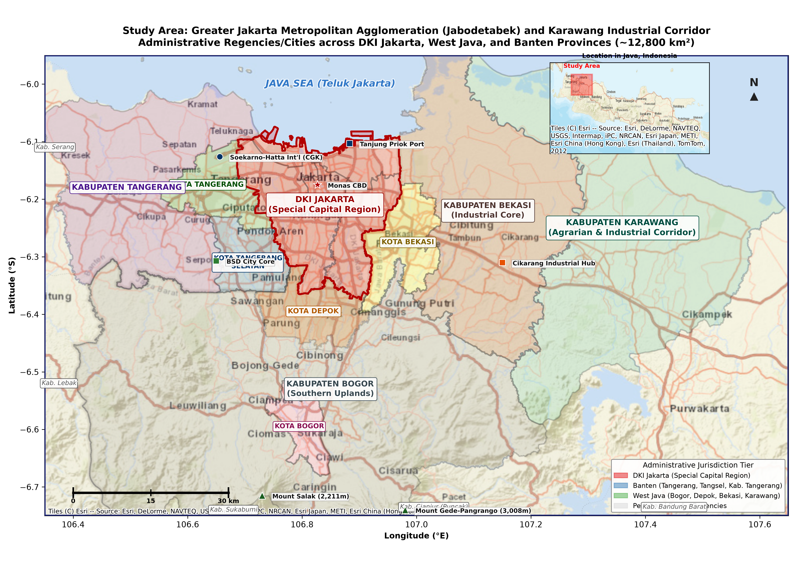

# 3. Study Area and Dataset

## 3.1 Study Domain: Greater Jakarta (Jabodetabek) and Karawang Corridor

The empirical investigation is situated across the Greater Jakarta metropolitan agglomeration (*Jabodetabek*—encompassing the Special Capital Region of Jakarta, Bogor, Depok, Tangerang, and South Tangerang) and the contiguous industrial corridor of Karawang Regency in West Java, Indonesia (Figure 1). Spatially bounded between coordinates $[106.35^\circ\text{E}, -6.75^\circ\text{S}]$ and $[107.65^\circ\text{E}, -5.95^\circ\text{S}]$, the study area encompasses approximately $12,800\text{ km}^2$ across 15 administrative municipalities (*Kota*) and regencies (*Kabupaten*) spanning three provincial jurisdictions: DKI Jakarta, West Java, and Banten.

*Figure 1. Study area map encompassing Greater Jakarta (Jabodetabek) and the Karawang industrial corridor (~12,800 km²), overlaid on an Esri WorldStreetMap basemap. Administrative boundaries delineate DKI Jakarta and constituent municipalities/regencies across Banten (Kota Tangerang, Kota Tangerang Selatan, Kabupaten Tangerang) and West Java (Kota Depok, Kota Bogor, Kabupaten Bogor, Kota Bekasi, Kabupaten Bekasi, Kabupaten Karawang). Major transportation hubs (CGK Airport, Tanjung Priok Port), urban cores (Monas CBD, BSD City, Cikarang), and southern volcanic landmarks (Mount Salak, Mount Gede) are indicated. Top-right inset highlights regional geographic placement within Java Island, Indonesia.*

With an enumerated harmonized population exceeding 40.73 million residents (derived via global human settlement layers; European Commission JRC, 2023), Jabodetabek represents one of the largest and densest megapolitan regions in the Global South. The area exhibits pronounced morphological dualism:
1. **Hyper-dense inner-city informal settlements (*kampungs*)**: Characterized by narrow, pedestrian-only alleys (*gang*), building coverage exceeding 80%, minimal private open space, unpaved drainage, and vulnerability to seasonal fluvial flooding along the Ciliwung and Cisadane river basins (Dovey et al., 2021; Rukmana, 2018).
2. **Master-planned corporate enclaves (*kota mandiri*) and gated communities**: Privately developed satellite townships such as Bumi Serpong Damai (BSD City), Lippo Karawaci, and Pantai Indah Kapuk (PIK), characterized by wide multi-lane arterial road grids, landscaped green spaces, artificial retention lakes, commercial superblocks, and physical perimeter security walls (Leisch, 2002; Winarso et al., 2015).
3. **The eastern industrial corridor (Bekasi–Cikarang–Karawang)**: Southeast Asia's largest automotive and manufacturing manufacturing cluster, exhibiting dense industrial labor housing juxtaposed directly against extensive, irrigated agricultural rice paddies.
4. **The southern peri-urban upland (Bogor Regency and Puncak)**: Mountainous foothills of Mount Salak and Mount Gede, exhibiting steep topographic gradients, agro-forestry, and informal tourist settlements sprawling along ridge axes.

To resolve the Modifiable Areal Unit Problem (MAUP; Openshaw, 1984) and eliminate arbitrary administrative census unit distortions, we discretize the entire $12,800\text{ km}^2$ study domain into an **Uber H3 Discrete Global Grid System (DGGS) at Resolution 8** ($N = 17,154$ hexagonal cells). Each hexagon maintains an invariant planar surface area of $0.737\text{ km}^2$ ($73.73\text{ hectares}$), a metric edge length of $\sim$461 meters, and uniform 6-neighbor centroid-to-centroid Euclidean spacing ($923\text{ m}$), establishing an isotropic spatial lattice optimal for Graph Neural Network message passing.

---

## 3.2 Multi-Source Dataset Inventory

To capture the complex multi-dimensional physical reality of human living environments without survey latency, we ingest, process, and harmonize 17 multi-modal datasets spanning Earth observation satellites, airborne sensor models, continental building vector geometry, topological street graphs, gridded human settlement layers, and atmospheric chemical transport reanalysis. All dynamic observation layers are synchronized to reference calendar year **2023** to eliminate temporal confounding.

Table 1 provides a comprehensive inventory of all primary datasets utilized throughout the data engineering, neural network modeling, and empirical validation phases of this research.

### Table 1: Comprehensive Multi-Source Dataset Inventory Across the Research Framework

| Category | Dataset | Source | Format | Spatial Resolution | Temporal Status / Acquisition Epoch | Research Relevance |
| :--- | :--- | :--- | :--- | :--- | :--- | :--- |
| **Spatial Base** | **Uber H3 DGGS (Res 8)** | [Uber Technologies](https://h3geo.org/) | Vector (Hexagon Polygons) | 0.737 km² / 461 m edge | Static (v4.1) | Discrete global grid establishing equal-area, MAUP-invariant graph nodes ($N = 17,154$) for neural spatial message passing. |
| **Built Environment** | **Google Open Buildings v3** | [Google Research](https://sites.research.google/open-buildings/) | Vector (Footprint Polygons) | Individual building footprints ($\ge 0.65$ conf) | 2023 release | Resolves structural footprint geometries to compute total built-up footprint area and building density. |
| **Built Environment** | **Open Buildings 2.5D Temporal** | [Google Research](https://sites.research.google/open-buildings/) | Tabular / Model Estimates | Building-level / 100 m | Annual composite 2023 | Predicts building floor counts to infer 3D living floor area per hexagon. |
| **Built Environment** | **JRC GHS-BUILT-S & GHS-BUILT-C** | [European Commission JRC](https://ghsl.jrc.ec.europa.eu/) | Raster (GeoTIFF) | 100 m | 2020 (interpolated to 2023) | Distinguishes residential from non-residential industrial warehouse structures to isolate true living floor mass. |
| **Demography** | **JRC GHS-POP** | [European Commission JRC](https://ghsl.jrc.ec.europa.eu/ghs_pop2023.php) | Raster (GeoTIFF) | 100 m | 2023 (interpolated from 2020 & 2025) | Enumerates resident population per cell (40.73M residents) to compute per-capita living space ($R_{\text{space}}$) and residential masks. |
| **Demography** | **JRC GHS-SMOD** | [European Commission JRC](https://ghsl.jrc.ec.europa.eu/ghs_smod2023.php) | Raster (GeoTIFF) | 1 km | 2020–2025 epoch | Degree of Urbanisation settlement typology used to delineate urban centers, dense clusters, and rural reference cells. |
| **Social Infrastructure** | **Overture Maps Places (GERS)** | [Overture Maps Foundation](https://overturemaps.org/) | Vector (Point Geometries) | Geocoded points (173,820 POIs) | 2024-02-15 (representing 2023) | Curated catalog of daily necessities (wet markets, warungs, clinics, schools, places of worship) to measure walkable amenities. |
| **Social Infrastructure** | **OpenStreetMap Road Network** | [Geofabrik / OSM](https://download.geofabrik.de/asia/indonesia/java.html) | Vector (Centerline Topology) | Metric network (4.08M nodes, 4.33M edges) | 2024-01-01 snapshot | Pedestrian walking network for `city2graph` 15-minute topological Dijkstra isochrone routing. |
| **Biophysical** | **Copernicus Sentinel-2 MSI L2A** | [ESA / Copernicus via GEE](https://developers.google.com/earth-engine/datasets/catalog/COPERNICUS_S2_SR_HARMONIZED) | Raster | 10 m / 20 m | Dry season 2023 (June–Oct; 62 scenes) | Multi-spectral surface reflectance used to compute NDVI (canopy), NDBI (built density), and BSI (bare soil) via Cloud Score+. |
| **Biophysical** | **Dynamic World 10m Land Cover** | [Google / WRI via GEE](https://developers.google.com/earth-engine/datasets/catalog/GOOGLE_DYNAMICWORLD_V1) | Raster | 10 m | 2023 composite (383 scenes) | High-resolution land cover probabilities to calculate surface water recurrence and validate canopy cover. |
| **Biophysical** | **JRC Global Surface Water (GSW)** | [European Commission JRC via GEE](https://developers.google.com/earth-engine/datasets/catalog/JRC_GSW1_4_GlobalSurfaceWater) | Raster | 30 m | Long-term multi-decadal recurrence | Identifies permanent deep water bodies (marine bays, major lakes) to prevent distorted terrestrial land evaluations. |
| **Microclimate** | **Landsat 8/9 C2 L2 (ST_B10)** | [USGS / NASA via GEE](https://developers.google.com/earth-engine/datasets/catalog/LANDSAT_LC08_C02_T1_L2) | Raster | 30 m (resampled from 100 m) | Dry season 2023 composite | Measures Land Surface Temperature (LST) and Surface Urban Heat Island ($\Delta\text{LST}$) elevation above rural background. |
| **Microclimate** | **MODIS Daily Daytime LST** | [NASA LP DAAC via GEE](https://developers.google.com/earth-engine/datasets/catalog/MODIS_061_MOD11A1) | Raster | 1,000 m | 2023 annual daytime median | Independent thermodynamic cross-sensor sanity benchmark against Landsat 8/9 LST ($\rho = 0.882$). |
| **Atmospheric Health** | **ACAG V6.GL.02.04 $\text{PM}_{2.5}$** | [Atmospheric Composition Analysis Group](https://sites.wustl.edu/acag/datasets/surface-pm2-5/) | Raster (NetCDF) | $0.01^\circ \times 0.01^\circ$ (~1.1 km) | 12 monthly grids for 2023 | Fused satellite-chemical transport model reanalysis quantifying ambient ground-level fine particulate pollution exposure. |
| **Atmospheric Health** | **Sentinel-5P TROPOMI $\text{NO}_2$** | [ESA / Copernicus via GEE](https://developers.google.com/earth-engine/datasets/catalog/COPERNICUS_S5P_OFFL_L3_NO2) | Raster | 1,113 m ($0.01^\circ$) | 2023 cloud-free annual median | Quantifies tropospheric nitrogen dioxide combustion emissions along vehicular expressways and industrial corridors. |
| **Infrastructure** | **NASA VIIRS Black Marble** | [NASA LAADS DAAC via GEE](https://developers.google.com/earth-engine/datasets/catalog/NOAA_VIIRS_DNB_MONTHLY_V1_VCMCFG) | Raster | 15 arc-sec (~464 m) | 2023 annual composite (VNP46A2) | Measures artificial nighttime luminosity to quantify nocturnal electrification and commercial energy density. |
| **Socioeconomic Validation** | **Meta Relative Wealth Index (RWI)** | [Meta Data for Good / HDX](https://data.humdata.org/dataset/relative-wealth-index) | Vector / Gridded Points | 2.4 km micro-tile quadkeys | 2021 release | Supervised survey asset wealth baseline used in 4-quadrant divergence analysis against physical living conditions. |
| **Socioeconomic Validation** | **BPS Municipal Statistics** | [Badan Pusat Statistik](https://www.bps.go.id/) | Tabular | Regency / District (*Kecamatan*) | 2023 annual releases | Official municipal poverty rates, density, and socioeconomic census data for macro-regional benchmarking. |
| **Ground-Truth Validation** | **Official Slum Decrees (SK Kumuh)** | [Bappeda DKI / PUPR Kotaku](https://kotaku.pu.go.id/) | Vector (GeoJSON / CSV) | Sub-neighborhood (*RW*) parcels | 2020–2023 decrees | Delineates surveyed informal settlements (*RW Kumuh*) for spatial validation of detected segregation friction boundaries. |

---

## 3.3 Ten-Dimensional Physical Feature Engineering and Universal Baselines

To eliminate regional normalization artifacts where scores cannot be transferred across cities, features are standardized against **Universal Frozen Physical Benchmarks** anchored to international shelter, health, and urban planning baselines (UN-Habitat shelter area threshold of $9.0\text{ m}^2/\text{capita}$, WHO clean air guidelines of $5.0\ \mu\text{g}/\text{m}^3$, and 15-minute pedestrian catchments; Table 2).

### Table 2: Universal 10-Dimensional Physical Living Standard Benchmark Parameters

| Dimension | Indicator Name | Unit | Transform | Lower ($L_k$) | Upper ($U_k$) | Orientation |
| :--- | :--- | :--- | :--- | :---: | :---: | :---: |
| **$X_1$** | **Space Sufficiency ($R_{\text{space}}$)** | Ratio | UN-Habitat $9.0\text{ m}^2$ Shelter Baseline | $0.0$ | $6.0$ ($54\text{ m}^2/\text{cap}$) | Positive |
| **$X_2$** | **Built-up Density ($\text{NDBI}$)** | Index | Impervious Spectral Response | $-0.50$ | $+0.30$ | Context |
| **$X_3$** | **Walkable Amenities ($A_{\text{amenity}}$)** | Count | 15-minute Walking Opportunities | $0.0$ | $\log(501) \approx 6.22$ | Positive |
| **$X_4$** | **Bare Soil / Dust Deficit ($\text{BSI}$)** | Index | Unpaved Dirt / Infrastructure Deficit | $-0.40$ | $+0.30$ | Inverted |
| **$X_5$** | **Nighttime Energy ($\text{VIIRS}$)** | $\text{nW}\cdot\text{cm}^{-2}\cdot\text{sr}^{-1}$ | NASA Black Marble Electrification | $0.0$ | $\log(101) \approx 4.62$ | Positive |
| **$X_6$** | **Canopy Greenness ($\text{NDVI}$)** | Index | Sentinel-2 Terrestrial Biomass | $-0.10$ | $+0.80$ | Context |
| **$X_7$** | **Thermal Comfort ($\Delta\text{LST}_{\text{inv}}$)** | Kelvin | Heat Island above Rural Background | $-5.0\text{ K}$ | $+15.0\text{ K}$ | Inverted |
| **$X_8$** | **Surface Water Frequency** | Fraction | Dynamic World Inundation Frequency | $0.00$ | $1.00$ | Context |
| **$X_9$** | **Fine Particulate Purity ($\text{PM25}_{\text{inv}}$)** | $\mu\text{g}/\text{m}^3$ | WHO 2021 Air Quality Guideline ($5.0\ \mu\text{g}$) | $5.0$ | $100.0$ | Inverted |
| **$X_{10}$** | **Nitrogen Dioxide Purity ($\text{NO2}_{\text{inv}}$)** | $\text{mol}/\text{m}^2$ | Sentinel-5P Combustion Exposure | $0.0$ | $2.5 \times 10^{-4}$ | Inverted |

*Note*: For positive indicators: $x_{\text{scaled}} = \text{clamp}\left(\frac{x - L}{U - L}, 0, 1\right)$. For inverted hazard indicators: $x_{\text{scaled}} = 1.0 - \text{clamp}\left(\frac{x - L}{U - L}, 0, 1\right)$. Amenities and nighttime radiance are compressed via natural logarithm: $x_{\text{trans}} = \log(1 + x)$.

Filtering by residential criteria ($\text{Pop} \ge 300/\text{cell}$, $\text{Buildings} \ge 1$, $\text{SMOD} \in \{21, 22, 23, 30\}$) isolates **$N_{\text{res}} = 9,345$ residential cells** ($54.5\%$ of territory, housing the entire 40.73M population), of which **$N_{\text{modelled}} = 7,943$ cells** possess complete satellite observations across all 10 channels. The remaining cells are retained in the spatial adjacency graph ($|E| = 101,848$ edges) to preserve topological contiguity for Graph Attention Autoencoder message passing in Stage 4.
